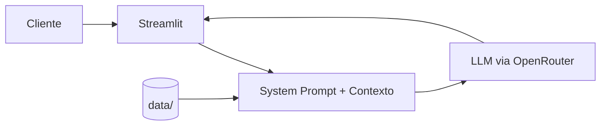

# 💰 Elisa — Educadora Financeira com IA Generativa

Agente conversacional que ensina finanças pessoais de forma simples, usando os **dados do próprio cliente** como exemplo prático. A Elisa **educa, não aconselha**: explica como cada conceito funciona, mas nunca recomenda onde investir.


---

## O problema

Muita gente quer aprender sobre finanças (reserva de emergência, tipos de investimento, organização de gastos), mas não sabe por onde começar e tem receio de perguntar.

## A solução

Uma "professora particular" disponível 24h, com linguagem acessível e exemplos baseados nas transações, no perfil e nas metas do cliente.

| | |
|---|---|
| **Persona** | Elisa, educadora paciente, informal e que nunca julga os gastos |
| **Público** | Iniciantes em finanças pessoais |
| **Respostas** | Curtas (máx. 3 parágrafos) e sempre confirmando se o cliente entendeu |

---

## Segurança e anti-alucinação

- Responde **apenas** com base nos dados fornecidos no contexto
- **Não recomenda** investimentos nem incentiva começar a investir
- Recusa perguntas fora do tema de finanças pessoais
- Admite quando não sabe: *"Não tenho essa informação, mas posso explicar..."*
- Não acessa senhas nem dados de outros clientes

---

## Como funciona



Ao iniciar, a aplicação carrega os arquivos de `data/` (perfil, transações, histórico de atendimento e produtos) e os injeta no *system prompt* junto com as regras da Elisa. O histórico da conversa é mantido na sessão.

**Stack:** Python · Streamlit · OpenRouter (`openai/gpt-4o-mini`) · Pandas

---

## Como rodar

```bash
git clone https://github.com/raulino-dev/intelligent-finance.git
cd intelligent-finance

pip install streamlit requests pandas python-dotenv

# crie um arquivo .env na raiz com sua chave
echo "OPENROUTER_API_KEY=sua_chave_aqui" > .env

# rode a partir da raiz (os caminhos de data/ são relativos)
streamlit run src/app.py
```

---

## Estrutura

```
├── data/    # Dados mockados (cliente fictício "João Silva")
├── docs/    # Documentação do agente
│   ├── 01-documentacao-agente.md   # Caso de uso, persona e arquitetura
│   ├── 02-base-conhecimento.md     # Estratégia de dados
│   ├── 03-prompts.md               # System prompt, exemplos e edge cases
│   ├── 04-metricas.md              # Cenários de teste e resultados
│   └── 05-pitch.md                 # Roteiro do pitch
├── src/     # Aplicação (app.py)
└── assets/  # Recursos visuais
```

---

## Avaliação

Testada em quatro cenários: **consulta de gastos**, **recomendação de investimento**, **pergunta fora do escopo** e **informação inexistente**. A Elisa respondeu corretamente com base nos dados, recusou o que está fora do tema e admitiu quando não tinha a informação. Detalhes em [`docs/04-metricas.md`](./docs/04-metricas.md).

---

> Projeto educacional com dados fictícios. A Elisa não substitui um profissional certificado.
